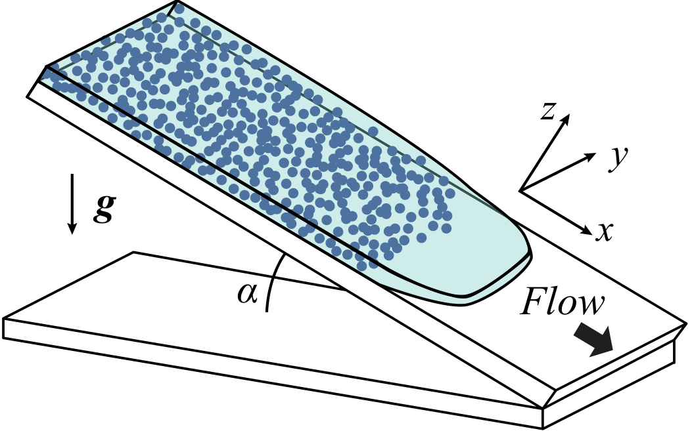
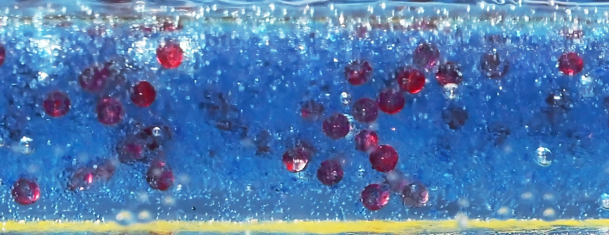

<div align="center">

# Transient Reverse Brazil Nut Effect in Particle-Laden Inclined Flows

**Liyao Lyu**<sup>1</sup>, **Lingyun Ding**<sup>1,†</sup>, **Yifan Gu**<sup>1</sup>, **Yanming Ba**<sup>2</sup>, **Andrea Bertozzi**<sup>1</sup>

<sup>1</sup>Department of Mathematics, University of California, Los Angeles &nbsp;·&nbsp;
<sup>2</sup>Department of Mathematics, Harvey Mudd College
<br><sup>†</sup>Corresponding author

[](paper/reverse_Brazil_nut_effect.pdf)
[](#citation)
[](https://github.com/Lyuliyao/reverse-brazil-nut-effect/actions/workflows/reproduce.yml)
[](LICENSE)
[](LICENSE-DATA)
[](requirements.txt)

[English](README.md) | [简体中文](README.zh-CN.md)

</div>

This repository contains the code, simulation inputs and processed data needed
to reproduce the numerical results of the paper, together with the
experimental image panels shown in the manuscript.

<p align="center">
  
</p>
<p align="center"><em>
Figure 6 of the paper. CFD–DEM simulation (d<sub>L</sub> = 600 µm,
d<sub>S</sub> = 200 µm, φ = 0.10, α = 30°) passing from a well-mixed state
through a transient RBNE phase and a mixed phase to the conventional BNE
ordering.
</em></p>

## Abstract

We report an experimentally observed transient reverse Brazil nut effect
(RBNE) in bidisperse particle-laden flows down an inclined plane. In certain
parameter regimes, the vertical particle distribution exhibits a three-phase
evolution: an early settling-dominated RBNE phase in which small particles lie
above large particles, an intermediate mixed phase, and a later recovery phase
of the conventional Brazil nut effect (BNE) where large particles reside above
small particles. A coupled transient segregation simultaneously develops in the
streamwise direction. A small-particle-leading front forms first and is later
overtaken by a large-particle front. Not all three phases have to occur in
every experiment: RBNE can disappear at a larger particle volume fraction, and
it can be the only persisting phase with a larger particle size ratio. We
interpret the RBNE behavior as a transient overshoot caused by the faster
onset of differential gravitational settling relative to the slower
development of contact-mediated kinetic sieving. We test this interpretation
using numerical simulations, where we successfully reproduce the
experimentally observed phases that also exhibit the same parameter dependence
as the experiments. Furthermore, through mechanism-isolation simulations, we
directly demonstrate the necessity of differential settling for the initiation
of RBNE and show that the subsequent recovery to BNE is driven by kinetic
sieving. Together, the experiments and simulations establish a coherent
process level picture of transient segregation in wet granular flows.

## Setup

<table>
<tr>
<td width="42%"></td>
<td>

A bidisperse suspension of negatively buoyant spheres in silicone oil is
released on a plane inclined at angle α. The coordinates are
*x* streamwise, *y* transverse and *z* normal to the incline.
Vertical segregation is measured by the mean-height difference

&nbsp;&nbsp;&nbsp;&nbsp;Δz̄(t) = z̄<sub>L</sub>(t) − z̄<sub>S</sub>(t),

so **Δz̄ < 0 is RBNE** (large below small) and **Δz̄ > 0 is BNE**
(large above small).

The simulations use CFD–DEM: OpenFOAM 6 coupled with
LIGGGHTS through CFDEMcoupling. The parameter sweep covers volume fractions
φ ∈ {0.05, 0.10, 0.20, 0.30, 0.40}, incline angles α ∈ {20°, 30°} and large
diameters d<sub>L</sub> ∈ {600, 1200} µm, with d<sub>S</sub> = 200 µm.

</td>
</tr>
</table>

<table>
<tr>
<td align="center"><br><sub>(a) well mixed</sub></td>
<td align="center"><br><sub>(b) RBNE</sub></td>
<td align="center"><br><sub>(c) mixed</sub></td>
<td align="center"><br><sub>(d) BNE</sub></td>
</tr>
</table>
<p align="center"><em>Figure 2 of the paper. Side-view experimental observation of the
three phases with large red (600–700 µm) and small blue (100–150 µm) particles.</em></p>

## Quick start

Replotting the paper figures requires only Python (≥ 3.9) and about one minute
of CPU time. The CFD–DEM solver is not needed.

```bash
git clone https://github.com/Lyuliyao/reverse-brazil-nut-effect.git
cd reverse-brazil-nut-effect
python -m venv .venv && source .venv/bin/activate   # Windows: .venv\Scripts\activate
python -m pip install -r requirements.txt

python scripts/validate_bundle.py      # integrity and consistency checks on the data
python scripts/reproduce_figures.py    # writes Figures 6–10 to outputs/figures/
```

With `make` available, `make all` runs the same two steps. Individual figures
can be selected:

```bash
python scripts/reproduce_figures.py --figures 6 9 10 --out outputs/selected
```

A conda environment is provided as an alternative: `conda env create -f environment.yml`.

## Reproducing the paper

| Figure | Content | Script | Data |
| :---: | --- | --- | --- |
| 1 | Schematic of the inclined-plane flow | — | [`paper/figure_assets/figure01.pdf`](paper/figure_assets/figure01.pdf) |
| 2–5 | Experimental side- and top-view observations | — | [`data/experiments/`](data/experiments/) (18 panels, see `manifest.json`) |
| 6 | Canonical transient segregation and fluid velocity profiles | [`analysis/figure06.py`](analysis/figure06.py) | `data/cases/bne_vf0p1_…_ang30/` |
| 7 | Effect of volume fraction φ and incline angle α | [`analysis/figure07.py`](analysis/figure07.py) | 10 sweep cases, d<sub>L</sub> = 600 µm |
| 8 | Effect of particle size ratio | [`analysis/figure08.py`](analysis/figure08.py) | 10 sweep cases, α = 30° |
| 9 | Species mean heights, contact and drag forces | [`analysis/figure09.py`](analysis/figure09.py) | canonical case |
| 10 | Mechanism-isolation controls | [`analysis/figure10.py`](analysis/figure10.py) | [`data/mechanisms/`](data/mechanisms/) |

The figures as typeset in the manuscript are kept in
[`paper/figure_assets/`](paper/figure_assets/) for side-by-side comparison
with the regenerated output.

**Mechanism-isolation controls (Figure 10).** Each control removes one
ingredient from the canonical case:

| Control | Modification | Outcome |
| --- | --- | --- |
| baseline | full incline gravity | transient RBNE, then recovery to BNE |
| settling-only | g<sub>∥</sub> = 0 (no downslope shear) | Δz̄ drops well below zero and does not recover within 40 s |
| shear-only | g<sub>⊥</sub> = 0 (no normal settling drive) | no clear RBNE; Δz̄ drifts slowly positive |
| equal settling | upward force F<sub>add</sub> = (8/9) W′<sub>L</sub> on each large particle, equalising the isolated-sphere Stokes settling velocities | early negative excursion essentially disappears; system proceeds to BNE |

Together these show that differential settling is necessary to initiate RBNE
and that the recovery to BNE is driven by kinetic sieving.

## Repository layout

```
.
├── analysis/            Figure scripts (figure06.py … figure10.py) and shared I/O
│   └── raw/             Post-processing tools for raw CFD–DEM output
├── cases/               Inputs of the 15 sweep cases and 4 mechanism controls
│                        (OpenFOAM CFD/, LIGGGHTS DEM/, case_params.json)
├── data/
│   ├── cases/           Per-case species mean-height time series, snapshots, fluid profiles
│   ├── mechanisms/      Mean-height curves of the mechanism controls (Figure 10)
│   └── experiments/     Experimental image panels of Figures 2–5
├── docs/                Data dictionary and provenance notes
├── paper/               Manuscript PDF and typeset figure assets
├── provenance/          Checksums, source mapping and validation records
├── scripts/             validate_bundle.py, reproduce_figures.py, extraction helpers
└── simulation/          Solver patches, case preparation and run scripts
```

## Data

All stored quantities use SI units; plots convert lengths to mm and velocities
to mm/s. The coordinate *z* is normal to the incline and points upward.
Particle type 1 is small and type 2 is large. Case names encode **radii**, so
`rs100um_rl300um` denotes d<sub>S</sub> = 200 µm and d<sub>L</sub> = 600 µm.
The mechanism-control baseline is a separate realisation from the canonical
case of Figure 6.

Full file formats are documented in
[`docs/data_dictionary.md`](docs/data_dictionary.md), and the mapping to the
original research archive is in [`docs/provenance.md`](docs/provenance.md).
The bundle contains processed quantities only. The full CFD fields, particle
trajectories and restart files (several TB), and the raw laboratory videos, are
not distributed here.

## Running new CFD–DEM simulations

New trajectories require Linux, MPI, OpenFOAM 6, CFDEMcoupling and LIGGGHTS
with the diagnostic patches in [`simulation/patches/`](simulation/patches/).
A typical workflow is

```bash
python simulation/prepare_case.py \
  --case bne_vf0p1_rs100um_rl300um_rho2470_cor0p1_mu0p5_ang30 \
  --out runs/canonical --end-time 40 --nprocs 8
bash simulation/run_case.sh runs/canonical /path/to/your/cfdem_env.sh
```

See [`simulation/README.md`](simulation/README.md) for pinned upstream
commits, patch application, the run script and analysis of new output.

## Citation

If you use this code or data, please cite the paper:

```bibtex
@misc{lyu2026transient,
  title         = {Transient Reverse Brazil Nut Effect in Particle-Laden Inclined Flows},
  author        = {Lyu, Liyao and Ding, Lingyun and Gu, Yifan and Ba, Yanming and Bertozzi, Andrea},
  year          = {2026},
  eprint        = {XXXX.XXXXX},
  archivePrefix = {arXiv},
  note          = {arXiv identifier to be added}
}
```

Machine-readable metadata are in [`CITATION.cff`](CITATION.cff); GitHub's
"Cite this repository" button uses that file.

## License

- **Code** (`analysis/`, `scripts/`, `simulation/*.py`, `simulation/*.sh`): [MIT License](LICENSE).
- **Data, figures and the manuscript** (`data/`, `cases/`, `paper/`, `docs/images/`): [Creative Commons Attribution 4.0 International](LICENSE-DATA).
- **Solver patches** (`simulation/patches/*.patch`) modify OpenFOAM, CFDEMcoupling
  and LIGGGHTS. They are derivative works distributed under the GNU GPL terms of
  those projects (see [`simulation/patches/licenses/`](simulation/patches/licenses/)),
  not under the MIT License.

## Acknowledgments

The authors acknowledge financial support from the U.S. National Science
Foundation grant DMS-2407006, the Simons Foundation Math + X Investigator Award
No. 510776, and the Department of Mathematics at Harvey Mudd College.
Computations were supported in part by the Institute for Cyber-Enabled Research
(ICER) at Michigan State University.

## Contact

Questions about the paper: Lingyun Ding (dingly@g.ucla.edu).
For questions about the code or data, please
[open an issue](https://github.com/Lyuliyao/reverse-brazil-nut-effect/issues).
